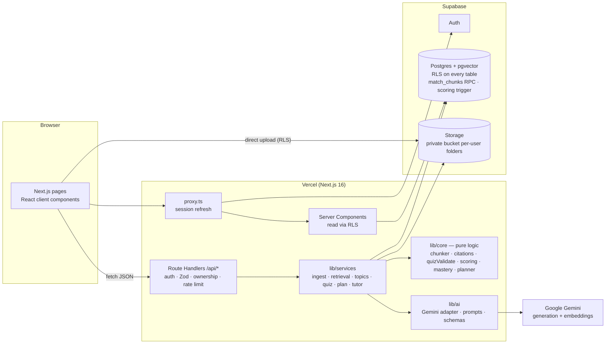

# Architecture

GapFinder AI is a single Next.js application deployed on Vercel. Its backend is a set of Route Handlers backed by managed services: Supabase (Postgres + pgvector, Auth, Storage) and Google Gemini. There is no separate Python or Express server, no local filesystem state, and no in-memory queue.



## Request lifecycle (route handler)
1. `requireApiUser()` creates a **user-scoped** Supabase client from cookies and verifies the JWT claims with `getClaims()`. Without a session the request gets a 401.
2. `getOwnedWorkspace()` explicitly checks that the workspace exists and belongs to the user (404 otherwise). This sits on top of RLS.
3. Zod parses the body.
4. `enforceRateLimit()` runs on AI endpoints and is backed by the `ai_usage` table.
5. The service runs. Every database call goes through the same user-scoped client, so **RLS applies to every query**, including retrieval.
6. `handle()` maps errors to safe JSON. `HttpError`, `ZodError` (400), `AiError` (429/502/503) and `ConfigError` (503) map to their status codes. Anything else returns a generic 500 and is logged on the server.

## Data model (summary)
`workspaces` 1─* `documents` 1─* `document_chunks` (embedding `vector(768)`, generated `tsvector`)
`workspaces` 1─* `topics` *─* `document_chunks` via `topic_chunks`
`workspaces` 1─* `quizzes` 1─* `quiz_questions` 1─1 `quiz_responses` (unique per question; correctness set by trigger)
`topics` 1─1 `topic_mastery` (current estimate) and 1─* `mastery_history` (one row per topic per quiz)
`workspaces` 1─* `revision_plans` (versioned, with `snapshot` and `change_summary`) 1─* `revision_tasks`
Plus `study_activity`, `tutor_messages`, `ai_usage` and `profiles`. Deletes cascade from the workspace (and from `auth.users`).

## What is AI and what is deterministic
| Step | Who | Guardrail |
|---|---|---|
| Text extraction, chunking | Deterministic (`unpdf`, `lib/core/chunker.ts`) | Page and heading metadata preserved; size caps |
| Embeddings | Gemini `gemini-embedding-001` | Shape-checked (768-d), L2-normalised |
| Retrieval | Deterministic (pgvector + FTS + RRF in SQL) | RLS-scoped; bounded context |
| Topic extraction | Gemini (JSON mode) | Zod; topics without valid passage labels discarded |
| Question generation | Gemini (JSON mode) | `lib/core/quizValidate.ts`: 4 distinct options, valid key, cites retrieved passages, verbatim quote found |
| Scoring | Deterministic (`lib/core/scoring.ts` + DB trigger) | Idempotent; insert-only responses |
| Mastery | Deterministic (`lib/core/mastery.ts`) | Documented thresholds in `lib/core/config.ts` |
| Revision plan & "what changed" | Deterministic (`lib/core/planner.ts`) | Budget never exceeded; overflow reported |
| Tutor explanation | Gemini (JSON mode) | Fresh retrieval; similarity floor; citation validation; "insufficient evidence" path |

## Mastery model
For each topic, over all graded responses:

```
w      = difficultyWeight(d) × 0.5^(ageDays / 14)        difficultyWeight: 1→0.8, 2→1.0, 3→1.2
score  = (Σ w·correct + 1) / (Σ w + 2)                    Beta(1,1) smoothing
state  = n < 2           → not_assessed
         score < 0.50    → weak
         score < 0.75    → developing
         otherwise       → strong
provisional = n < 5
```
Reasons are generated deterministically: counts, missed or aced hard questions, missed foundational questions, improving or declining trend across quizzes, and the provisional notice.

## Planner
- **Budget** = `min(days_to_exam, 14) × hours_per_day × 60` minutes.
- **Priority** = `importance × gapWeight(state)` (weak 3, not assessed 2.5, developing 2, strong 0.5) + `0.5 × (1 − score)` + a 1-point decline bonus.
- **Templates:** weak → read 30 + tutor 10 + practice 15; developing → read 15 + practice 15; not assessed → assess 10; strong → review 10.
- **Scheduling:** first-fit into days by priority, keeping each topic's activities in order. Tasks that don't fit are returned as `unscheduled`.
- **Replanning:** completed tasks are copied forward. Already-done activities are skipped while a topic's evidence is unchanged. `diffSnapshots()` explains changes (improved, dropped, newly assessed, score moved).
